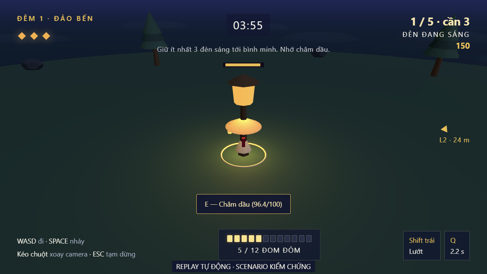
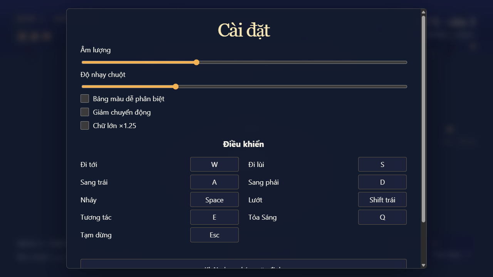

# Đảo Đèn Lồng

**[Video demo MP4 — replay tự động và bằng chứng](docs/demo/demo.mp4)** · **v1.0.0 / Contract v1.3**

Game web 3D góc nhìn thứ ba: Mây thu đom đóm, thắp và châm dầu cho Đèn Lồng Lớn,
giữ Đảo Bến, Đảo Cau và Đảo Chuông sáng tới bình minh.

**Sinh viên:** Đỗ Minh Hoàng · **MSSV:** 2A202603554 · **Khóa/lớp:** K5-L3A.



## Chạy trong 3 lệnh

Cần Node.js 22+, mạng khi cài dependency lần đầu, và trình duyệt hỗ trợ WebGL 2.
macOS, Linux và Windows dùng cùng lệnh; benchmark cần phiên desktop có GPU/driver WebGL:

```sh
npm ci
npm run build
npm start
```

Mở http://localhost:4173. Bấm **Thắp lại hòn đảo**, đọc lời Ông Đăng và bắt đầu.
`dist/` là bản web tĩnh, không cần CDN, có thể phục vụ bằng HTTP server khác.

## Điều khiển và luật chơi

| Phím | Hành động |
|---|---|
| WASD | Đi theo camera |
| Kéo chuột | Xoay camera |
| Space | Nhảy |
| Shift | Lướt |
| E | Nạp đèn / châm dầu vào đèn nhận được gần nhất |
| Q | Tỏa Sáng, tốn 3 đom đóm |
| Esc / P | Tạm dừng / tiếp tục |

Sức chứa ban đầu **10**, tăng 2 mỗi lần thắp thành công, kể cả thắp lại, tối đa **20**.
Thắp lần đầu cần **10** đom đóm; đèn đã từng sáng chỉ cần **5** để thắp lại.
Đèn đầy có **100 dầu**, hao **1/giây**. E châm **10 dầu/đom đóm** theo
`used=min(carried,ceil((100-fuel)/10))`. Cạn dầu làm đèn tắt và xóa tiến độ nạp.
Thứ tự tick trừ dầu trước tương tác: đèn đầy ở snapshot 0 đã thiếu 1/60 dầu khi E được xử lý.

Đèn dưới **30 dầu** nhấp nháy **1 Hz** và mất vùng an toàn; đúng 30 vẫn an toàn trong 6 m.
Bóng Mực wander tìm đèn yếu, đứng hút **5 dầu/giây/con** trong 2 m. Dùng Tỏa Sáng
để ngắt hút. Thanh dầu nằm trên các đèn đang sáng.

**Không thắng sớm khi thắp hết đèn.** Đêm 1/2/3 dài **240/270/300 giây**;
ở tick bình minh cần ít nhất **3/5, 4/6, 5/7** đèn đang sáng và Mây còn sống.
Hết Ngọn Lửa luôn thua, kể cả ở tick cuối. Có chơi lại Đêm và chuỗi ba Đêm;
tổng điểm chỉ cộng các Đêm đã thắng.

Tỏa Sáng: bán kính 3D 5 m, choáng 2 s, đẩy 4 m trong 15 tick, hồi 3 s.
Lướt: 14 m/s trong 0,2 s, hồi 1,5 s, không bất tử. Bùa Gió tăng tốc chạy lên
7,2 m/s và bỏ hồi lướt trong 10 s. Rơi Y < −10 mất 1 lửa và toàn bộ carry, chờ 1 s hồi sinh.
Đêm 2 có cầu tre/bục đỏ; Đêm 3 có tầng/dốc/bục và gió có báo trước. Gió Lạc cướp đom đóm,
dùng Tỏa Sáng để xua hoặc lấy lại đồ.

Điểm v1.2: **+5/đom đóm nạp**, +100 thắp lần đầu, +40 thắp lại; pulse tổng +5/Bóng Mực,
tổng +15 nếu nó đang drain. Khi thắng: mỗi đèn sáng +50+floor(fuel), mỗi lửa còn +50.
**Không thưởng thời gian**. Số liệu dùng thật: [game.contract.json](game.contract.json).

Pause → Cài đặt → **Bảng màu dễ phân biệt**: viền/mắt Bóng Mực cyan, cảnh báo trắng kèm ⚠.
Palette, âm lượng và độ nhạy chuột được lưu giữa các lần mở. Đèn tắt xẹp 20% và có vết rách
để phân biệt bằng hình dáng ở cả chế độ màu thường.

Phase 4 thêm đổi toàn bộ 9 phím trong Cài đặt (có báo trùng và khôi phục mặc định),
**Giảm chuyển động**, **Chữ lớn ×1.25**. Chữ UI tối thiểu 18 px ở 1280×720,
chữ lớn 22,5 px. Có chỉ báo hình ảnh cho Bóng Mực xuất hiện kèm mũi tên,
gió sắp thổi, 10 giây cuối và đèn yếu. Reduced motion tắt blink nhân vật,
orbit menu/easing camera và nhấp nháy cảnh báo UI; không có rung camera/chớp toàn màn hình.



## Bảng xếp hạng cục bộ

Sau khi thua hoặc thắng Đêm 3, nhập tên 3–12 ký tự `[A-Za-z0-9_]` để lưu.
Điểm lưu là tổng các Đêm đã thắng; top 10 sắp theo điểm giảm, bằng điểm theo thời gian đạt trước.
Menu có **Bảng xếp hạng** và **Xuất JSON**. Server lưu `.local/leaderboard.json`;
đổi nơi lưu bằng `LANTERN_DATA_DIR`. File điểm người chơi không đưa vào Git.

```sh
node scripts/serve.mjs --export-leaderboard out.json
```

Nếu chỉ phục vụ `dist/` trên static hosting không có Node API, bảng dùng localStorage
và xuất JSON bằng nút trong UI. CLI chính thức đọc file của server Node; dùng server này khi chấm export.

Đêm 3 có điểm chưa rõ trong đề: origin v1.0 (0,0,0) nằm dưới tầng 2/tháp.
Bản chơi dùng điểm đáp (0,6,6); headless vẫn giữ origin contract hoặc vị trí scenario.
Đây là giả định thiết kế cho phần đề chưa định nghĩa, được ghi trong [spec Phase 2](docs/specs/phase-2.md).

## Test, headless và bằng chứng

```sh
npm test
npm run verify -- --phase 4
node src/headless.mjs --seed 42 --night 2 --ticks 600 --out output.jsonl
```

CLI nhận `--night 1|2|3`, thêm `--scenario file.json --inputs file.json --snapshot-every 10`.
60 tick/s, không GPU/cửa sổ, không chờ thời gian thực. Snapshot 0 trước input;
input k tạo trạng thái/event k+1. Pause tăng tick nhưng giữ sim_tick, dầu và timer.
JSONL kết thúc bằng `end`; dữ liệu sai trả mã 2 và thông báo ra stderr.
Mỗi đèn snapshot có fuel (làm tròn 1 số lẻ), ever_lit, relit_count; player có capacity.

```sh
node scripts/replay-scenarios.mjs
node scripts/replay-scenarios.mjs .work/phase3 tests/scenarios/phase-3/manifest.json
node scripts/bench.mjs --seed 42 --duration 30 --out bench.json
node --expose-gc --max-semi-space-size=1 src/soak.mjs --seed 7 --nights 10 --out soak.json
npm run verify:clean -- 4 --working-tree
```

**76 test**, gồm 18 scenario CLI có kỳ vọng, mỗi scenario chạy hai lần so từng byte
và giữ nguyên hash output Phase 3. Có thêm test bench fixture/công thức, keybinds và leaderboard disk/HTTP/export.
[Bằng chứng Phase 1](docs/proof/phase-1/README.md), [Phase 2](docs/proof/phase-2/README.md),
[Phase 3](docs/proof/phase-3/README.md), [Phase 4](docs/proof/phase-4/README.md).
`scripts/benchmark.mjs` cũ chỉ đo throughput headless; **không** phải benchmark FPS v1.3.
Do chưa được commit, clean check Phase 4 tạo snapshot working tree trên clone sạch,
ghi rõ base commit và hash file; không nhận snapshot này là tag đã phát hành.

## Benchmark và soak

Benchmark dùng Electron và **cùng renderer** Three.js, 1280×720, warmup 3 s rồi đo 30 s.
200 Bóng Mực wander, 100 đom đóm, 3 đèn; tắt sinh thêm/sát thương/nhặt/dầu/kết thúc và
chi tiết sáng tạo (moon/stars/clouds/cây/bob). Camera orbit 30 m, Y=15, 15 s/vòng.
Launcher truyền `disable-frame-rate-limit` và `disable-gpu-vsync`; switch đầu cũng ngụ ý
tắt GPU vsync theo [mã nguồn Chromium](https://chromium.googlesource.com/chromium/src/+/HEAD/components/viz/common/switches.cc).
Raw dt ở `bench.frames.json`, chi tiết cảnh ở `bench.details.json`; P95 dùng nearest-rank.
`peak_mem_mb=null`: bản web không có RSS riêng đáng tin cậy cho trang/GPU dùng chung;
RSS của headless được đo riêng trong soak.

Kết quả máy hiện tại: **296,9 FPS trung bình**, **170,8 FPS 1% low**, **load 1.173,5 ms**.
Soak 10 Đêm cùng process: **0 crash**, RSS khoảng **38,66 → 45,64 MB**, dưới ngưỡng +20%.
Các kết quả gốc là [bench.json](bench.json), [soak.json](soak.json); máy chấm của Coach mới quyết định điểm.
Soak dùng seed `7+i` với i=0…9, chọn hướng mỗi 30 tick; GC tại ranh giới và nursery 1 MB
để đo RSS nhất quán, không tăng baseline bằng dữ liệu đệm.

Video dài khoảng 65 s, không có tiếng, quay trang render thật bằng FFmpeg từ replay có scenario/input công khai.
Video hiển thị log test, output headless, bench và soak thật; **không phải thao tác chơi tay**.
Quay lại bằng `npm run demo:record` sau khi chạy verify/bench/soak và build.

CI test/build trên Windows, macOS, Linux. Hook chặn commit khi test đỏ:
`git config core.hooksPath .githooks`.

## Sáng tạo của tôi

Biển mây, cây low-poly, trăng/sao, ánh đom đóm nhấp nhô, vòng Tỏa Sáng và chiếc đèn nhỏ
trên nón lá đều tạo bằng hình học thủ tục. Nhạc/hiệu ứng tổng hợp bằng WebAudio.
Trang trí/âm thanh không dùng RNG gameplay; headless không khởi tạo renderer.
Test kiểm tra tính tất định; ảnh/video lấy trực tiếp từ ứng dụng đang chạy. Chi tiết sáng tạo tắt trong benchmark/soak.

## Hồ sơ lab

- [Spec Phase 1](docs/specs/phase-1.md), [Phase 2](docs/specs/phase-2.md), [Phase 3](docs/specs/phase-3.md).
- [Spec Phase 4](docs/specs/phase-4.md).
- [ADR-003](docs/adr/003-lantern-fuel-and-dawn.md), [breaking changes](CHANGELOG.md).
- [Tiến độ](docs/notes/progress.md), [nhật ký AI/token ước tính](docs/notes/ai-log.md), [retro](docs/notes/retro.md).
- [Harness](AGENTS.md), [lab gốc](docs/lab/README-original.md), [checkpoints](CHECKPOINTS.md), [nộp bài](SUBMISSION.md).
- [Nguồn](CREDITS.md), [LICENSE](LICENSE).
- [Hướng dẫn bàn giao](SUBMISSION.md#9-bàn-giao-bản-này): push lên `main` sẽ chạy kiểm tra và tự tạo tag `phase-4`, Release `v1.0.0` kèm ZIP/video khi đạt. Xem trạng thái thực tế ở tab Actions/Releases; tài liệu này không khẳng định workflow đã chạy.
- Không cần fork/tạo thêm repo: dùng repo cá nhân hiện tại đúng tên/public theo [SUBMISSION.md](SUBMISSION.md).
